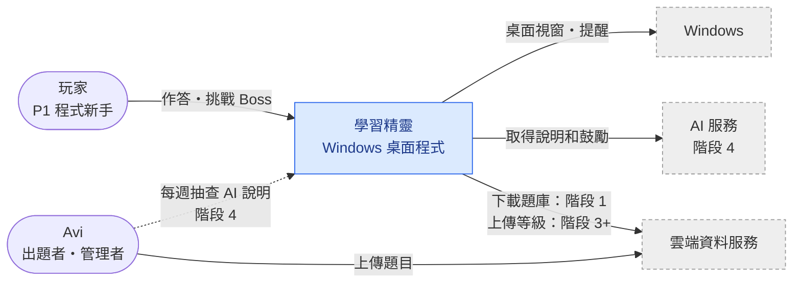
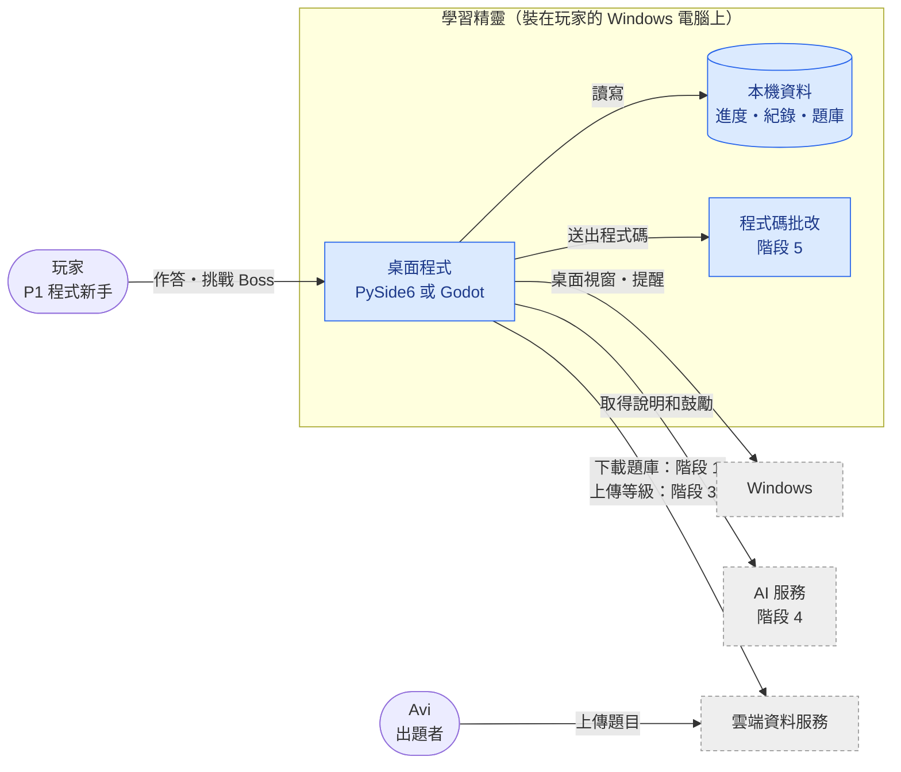

# C4 Architecture: 學習精靈 v1

**Status:** Draft v0.2 · **Owner:** Avi · **Last updated:** 2026-11-08

> [!NOTE]
> 依據：`prd.md` v0.6、`roadmap.md` v0.1、`acceptance-criteria.md` v0.1、`adr-001-desktop-framework.md`（Proposed）、`project-brief.md`。**目前沒有程式碼**（工作包要求的 `codebase-structure` 不存在），所以這是「v1 規劃中的架構」，不是現有系統的描述。範圍、題目來源、互看等級的伺服器、從哪個階段開始下載題目由 Owner 決定（2026-11-08：1A 2B 3B、C）。
>
> **階段標記：** 每個元素和連線後面的「階段 N」對應 `roadmap.md` §2，表示從哪個階段開始才有。

---

## 1. Executive Summary

- **給誰看：** Avi 自己開發時對照用，以及之後請老師、同學或 AI 協助時，快速看懂學習精靈由哪些部分組成、和哪些外部服務有關。**[M]**
- **畫哪幾層：** Level 1（System Context）和 Level 2（Container）。範圍是 v1 完整版（階段 1～5，加上同學互看等級），每個元素標出從哪個階段開始才有。（依據：Owner 決定 2026-11-08，1A）
- **不畫的部分：** Level 3（Component）和 Level 4（Code），因為還沒有程式碼，桌面程式框架也還沒選定（ADR-001 Proposed）。階段 0 的 Google 表單＋試算表不在圖上，因為 v1 不沿用。（依據：prd §10 5A）
- **最大的未知：** 桌面程式（ADR-001）、本機存資料（ADR-002）、階段 1 題庫放在 GitHub（ADR-003）、AI 服務（ADR-004）、程式碼批改（ADR-005）、階段 3+ 的雲端（ADR-006）都已有 ADR，但全部還是 Proposed，要等各自的小試驗或實測。**[L]**

> **TL;DR:** 學習精靈是裝在玩家 Windows 電腦上的桌面程式，進度存在本機；它依賴三個外部系統：Windows（桌面 Boss、開機自動執行、提醒）、AI 服務（解釋錯題、鼓勵，階段 4）、雲端資料服務（下載新題目、同學互看等級）。

---

## 2. Level 1 — System Context

> 圖的畫法：為了避免文字重疊，改用 Mermaid `flowchart`，不用工作包建議的 `C4Context` 語法（Owner 同意 2026-11-08）。分層規則照舊：Level 1 只放系統、使用者和外部系統。

圖例：圓角框是使用者；藍色框是學習精靈；灰色虛線框是外部系統；虛線箭頭表示取得方式還沒定（TODO）。

### Actors & External Systems

| Element | Type | Responsibility | Confidence | Source |
|---|---|---|---|---|
| 玩家（P1 程式新手） | Actor | 課後做練習題培養自己的職業角色；挑戰桌面 Boss | **[M]** | persona §P1；prd §1 |
| Avi（出題者／管理者） | Actor | 出題、每題寫好觀念說明（給 AI 參考，也是沒網路時的備用說明）、每週抽查 20 則 AI 說明 | **[M]** | prd FR-3、§6 AI 說明正確性、§9 R2；roadmap §2 階段 1 說明 |
| 學習精靈 | System | Windows 桌面程式，負責 FR-1～FR-6 | **[H]** | prd §1、§6 Platform |
| Windows 作業系統 | External | 讓 Boss 和提醒以透明、無邊框、最上層的視窗出現在桌面上；開機自動執行 | **[M]** | prd §6 Platform、FR-5、FR-6；acceptance-criteria AC-4、AC-9；adr-001 §2 |
| AI 服務（ADR-004：透過雲端代理呼叫，哪一家待階段 4 前實測） | External | 針對玩家自己的答案解釋錯在哪；在答錯、升級、打倒 Boss、一段時間沒練習時鼓勵玩家。PRD 不指定是哪一家 | **[M]** | prd FR-3、FR-6、§10（4-1A）；roadmap 階段 4 |
| 雲端資料服務（階段 1 題庫：GitHub 公開 repo，ADR-003；階段 3+：Firebase 或 Supabase 類＋匿名登入，ADR-006） | External | 階段 1 起：放題庫讓程式下載新題目（只下載，不上傳任何玩家資料）。階段 3+：存每個人的經驗值和等級，讓同學互看。用現成服務，不自己寫伺服器 | **[L]** | Owner 決定 2026-11-08（2B、3B、C）；roadmap §2 階段 1、3+；prd §6 Privacy |

---

## 3. Level 2 — Containers

> 圖的畫法同 §2，改用 Mermaid `flowchart`（Owner 同意 2026-11-08）。

| 容器 | 做什麼 | 技術 | 階段 | 信心 |
|---|---|---|---|---|
| 桌面程式 | 出題、算經驗值、角色、Boss 戰、提醒 | PySide6 或 Godot（待 ADR-001） | 1～5 | **[M]** |
| 本機資料 | 存進度、作答紀錄、題庫 | SQLite（ADR-002，Proposed） | 1 | **[M]** |
| 程式碼批改環境 | 執行玩家的程式、判斷對錯 | 本機獨立 Python 程式（ADR-005，Proposed） | 5 | **[L]** |

「信心」指的是職責；三個容器的技術都還沒定，都是 **[L]**。

### 容器說明

**桌面程式**
- 從題庫隨機出題、判斷選擇題對錯、計算經驗值與升級（3 秒內更新）、職業與技能、角色外觀、桌面 Boss 即時戰鬥與寶物、超過 1 天沒練習時提醒、答錯時顯示說明。
- 技術：PySide6（Python）或 Godot 4（GDScript），等 ADR-001 小試驗結果決定。
- 來源：prd FR-1～FR-6、§6 Latency；acceptance-criteria AC-1～AC-13；adr-001 §3、§6

**本機資料**
- 存經驗值、等級、作答紀錄（AC-5 欄位）、職業與技能、寶物；關機重開後還在；寫入失敗時不加經驗值。
- 也存題庫和觀念說明：安裝檔附一份基本題庫，之後從雲端下載的新題目也存在這裡，讓沒網路時也能練、也能顯示備用說明。
- 技術：SQLite，一個檔案放在 `%APPDATA%\學習精靈\`；作答紀錄可以匯出成 CSV，由同學自己傳給 Avi（`adr-002-local-storage.md`，Proposed，等 ADR-001 小試驗第 4 項確認）
- 來源：acceptance-criteria AC-5、AC-9～AC-13、§4 Privacy；prd FR-3（4-4A）；adr-001 §6 Follow-up；Owner 決定 2026-11-08（C）

**程式碼批改環境**
- 執行玩家填空的 Python 程式碼，判斷對錯，回傳結果給桌面程式計算遞減經驗值。
- 技術：在玩家電腦上用另一個獨立的 Python 程式執行、限時、比對輸出（`adr-005-code-grading.md`，Proposed；時間上限 TODO）
- 來源：prd FR-1（寫程式題）、FR-2、§9 R2；adr-001 §2

**分層說明**
- Boss 戰、提醒、角色都算在「桌面程式」裡，沒有拆成獨立的容器。這些部分是不是獨立執行的程式，要等 ADR-001 選定框架後才知道；拆開屬於 Level 3（Component），本文件不畫。
- 「程式碼批改環境」最後可能併入桌面程式。先畫成獨立容器，是為了標出階段 5 的安全風險（見 §9 R5）。

---

## 9. Architecture Risks

> **R1（單點故障）：進度只存在玩家自己的電腦** — 硬碟壞掉、重灌或換電腦，經驗值、等級、職業、寶物和作答紀錄就全部不見。雲端只存經驗值和等級（3B），救不回其他資料。 — **Severity:** M — **Follow-up:** 已決定 v1 不備份，接受這個風險（ADR-002，Owner 決定 2026-11-08，4A）；階段 2 以後有職業、寶物時重新考慮。
>
> **R2（跨邊界的頻繁呼叫，影響 3 秒內更新）：作答流程如果要等雲端或 AI 回應** — 如果每次作答都先上傳到雲端、或等 AI 說明產生完才顯示經驗值，網路慢時就會超過 p95 < 3 秒。 — **Severity:** H — **Follow-up:** 寫 ADR 時明訂：經驗值和等級一律先在本機計算、存檔、顯示，上傳雲端和呼叫 AI 都在背景進行，不阻擋畫面更新。（依據：prd §6 Latency；acceptance-criteria AC-1、AC-2）
>
> **R3（外部依賴、單點）：雲端資料服務連不上或停止服務** — 程式下載不到新題目，玩家很快就把題庫做完，R1「持續練習」會更難達成；同學互看等級也會失效。綁定一家服務，之後要換也比較麻煩。 — **Severity:** M — **Follow-up:** 題庫下載後存在本機（見 §12 假設）；階段 1 題庫放在 GitHub 免費方案，只有 2 個檔案，換服務只要改網址（ADR-003）；階段 3+ 另寫 ADR 時再比較服務和費用。
>
> **R4（外部依賴）：AI 服務斷線、出錯或費用超出** — 沒有說明就解決不了 JTBD-003；AI 說明錯誤也會教錯觀念。 — **Severity:** M — **Follow-up:** 已有備用說明（prd FR-3 4-4A）和每週抽查（prd §6）；金鑰放在雲端代理、限制每人每天次數（ADR-004，Owner 決定 1A）；費用上限、選哪一家待階段 4 前實測（ADR-004，2B）。
>
> **R5（安全）：階段 5 在玩家電腦上執行玩家寫的程式碼** — 玩家的程式如果寫出無窮迴圈或刪檔指令，可能讓學習精靈當掉，甚至影響玩家的電腦。 — **Severity:** M — **Follow-up:** 獨立程式執行＋時間上限＋暫存資料夾＋禁止危險模組（ADR-005，Owner 決定 5A）；時間上限秒數 TODO。
>
> **R6（存取權限、作弊）：雲端的經驗值由每台電腦自己上傳** — 存取權限設錯，同學會看到別人的答案（違反 prd §6 Privacy）；而且玩家可以改本機資料或直接改上傳的數字，讓互看的等級失去可信度（R1 第 12 題的「在坑自己」問題）。 — **Severity:** M — **Follow-up:** 匿名登入＋「只能改自己那一筆」的權限規則，只公開 3 欄；防竄改只做基本檢查（經驗值只增不減、等級符合公式、不超過題數 × 10），接受合理範圍內的作弊（ADR-006，Owner 決定 3A、4A）。
>
> **循環依賴：** 目前沒有發現。所有連線都是桌面程式往外呼叫；雲端資料服務和 AI 服務不會反過來呼叫桌面程式。**[M]**

---

## 12. Confidence & Sources & TODO

- **整份文件最低 confidence 欄位：** 雲端資料服務、程式碼批改環境、所有容器的技術欄位都是 **[L]**；桌面程式和本機資料的職責、Windows、AI 服務、兩個 actor 是 **[M]**。只有「學習精靈是 Windows 桌面程式」是 **[H]**。
- **已解決的 CONFLICT（Owner 決定 2026-11-08，C）：** 2B「從雲端下載新題目」原本和 roadmap（伺服器在階段 3 之後）、acceptance-criteria §4 Privacy（驗證「沒有任何對外連線」）不一致。決定：**階段 1 就從雲端下載題庫，但只下載、不上傳任何玩家資料**；安裝檔附一份基本題庫；上傳經驗值和等級、同學互看維持在階段 3 之後。roadmap 和 acceptance-criteria 已同步修改（v0.2）。
- **Fabricated assumptions（推測但 input 未明說）：**
  - 下載的新題目會和基本題庫一起存在本機，讓沒網路時也能練、也能顯示備用說明（依 prd FR-3 4-4A 推得）。
  - Avi 直接編輯 GitHub 題庫 repo 的檔案，跑檢查程式後 push，不另外做出題工具（ADR-003，Owner 決定 2026-11-08，4A）。
  - 經驗值和等級什麼時候上傳（每次作答後，或定期）沒有說明；圖上只畫「上傳、讀取」。
  - 職業、技能、寶物、作答紀錄只存在本機，不上傳雲端（3B 只提到經驗值和等級）。
  - Avi 每週抽查的 AI 說明，假設會存在某處讓 Avi 取得；存在本機或雲端都還沒定。玩家的作答資料只在自己電腦上，由同學自己匯出 CSV 傳給 Avi（ADR-002，Owner 決定 2026-11-08，3A）。
  - Windows 畫成外部系統，是因為桌面透明視窗、開機自動執行、提醒都依賴作業系統功能。
  - Boss 戰、提醒、角色都和桌面程式是同一個容器（見 §3 分層說明）。
- **Highest-value next input:** ADR-001 小試驗的結果（決定桌面程式的技術），小試驗第 4 項也會確認 ADR-002 的 SQLite。

### TODO（缺資料）

- ~~題庫檔案放在哪個雲端服務~~ → GitHub 公開題庫 repo（`adr-003-cloud-data-service.md`，Proposed）
- _TODO: 桌面程式的框架，需要 ADR-001 小試驗結果_
- ~~本機存資料的方式~~ → 已寫 `adr-002-local-storage.md`（Proposed，暫定 SQLite）
- _TODO: 階段 3+ 選 Firebase 或 Supabase（ADR-006 小試驗）；階段 3 是否只用免費方案_
- _TODO: 要用哪個 AI 服務、每月費用上限（ADR-004：階段 4 前實測 20 題再選）_
- ~~程式碼批改的方式~~ → ADR-005（Proposed）；_TODO: 時間上限秒數_
- _TODO: Avi 怎麼上傳新題目、怎麼取得 AI 說明來抽查_
- _TODO: 要不要防止玩家竄改上傳的經驗值，待 Owner 決定_
