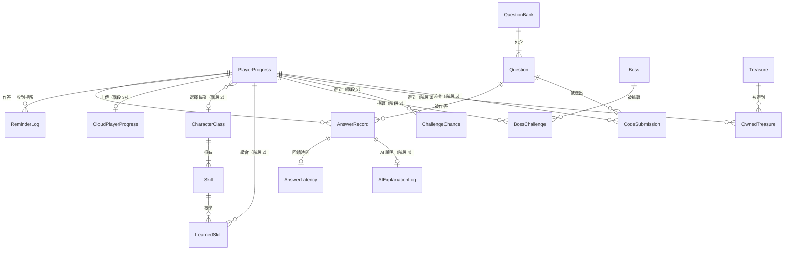

# Data Model: 學習精靈 · 本機進度與題庫（階段 1）＋雲端經驗值（階段 3+）

**Status:** Draft · **Owner:** Avi（Claude 起草） · **Last updated:** 2026-11-09

> **說明：** 專案沒有 SRS 和 business-rules 文件，改用 `prd.md` v0.7、`acceptance-criteria.md` v0.3、`roadmap.md` v0.3、`api-spec.md` v0.1、`c4-diagram.md` v0.2 當依據。
>
> **寫法（Owner 決定 2026-11-08，3A）：** 這是**邏輯模型**，不綁定儲存方式（SQLite、JSON 檔或其他，待「本機存資料」ADR）。型別用通用名稱（text、integer、boolean、datetime、list）；§6 的索引寫成「需要支援的查詢」，等 ADR 選定後再對應到實際做法。
>
> **更新（2026-11-08）：** `adr-002-local-storage.md`（Accepted）選定 SQLite，存在 `%APPDATA%\學習精靈\`；§6 的索引已對應成 SQLite 索引。作答紀錄可以匯出成 CSV（AC-14），包含量 Latency 用的 `update_ms`（non-functional-reqs L1，2026-11-08 新增；2026-11-09 Owner 決定 A，另存在 AnswerLatency）。

---

## 1. Executive Summary

- **範圍（Owner 決定 2026-11-08，1C）：** 階段 1 核心循環寫完整欄位：玩家進度、題目、題庫版本、作答紀錄、提醒紀錄，加上作答回饋時間（AnswerLatency，2026-11-09 Owner 決定 A），共 6 個 entity，存在使用者自己的電腦；加上 `api-spec.md` E3/E4 的雲端玩家進度（階段 3+），共 7 個。階段 2～5（職業、技能、寶物、Boss、AI、寫程式題）只畫關係，欄位等 PRD 的 TODO 補齊後再寫（依據：roadmap 階段 1～5；prd FR-4、FR-5 TODO）。
- **個資（Owner 決定 2026-11-08，2B）：** 維持輕量版，不升級到完整版。上傳到雲端的只有暱稱、經驗值、等級三個欄位，而且規定**暱稱不能用真名**；作答紀錄只存在自己的電腦（依據：prd §6 Privacy；acceptance-criteria §4 Privacy；api-spec E4）。注意：concierge 測試的資料（`學習精靈 · 第 1 週經驗值 - 表單回覆 1.csv`）不匯入學習精靈。（2026-11-09 Owner 確認：問卷是匿名的；concierge 測試只有暱稱，其中一個像真名的已改成「同學 E」，連同 git 紀錄一起改寫；專案 repo 公開在 `Ruijun711/leveling`）
- **稽核欄位：** 依工作包規定，每個 entity 都有 `created_at`、`updated_at`、`version`、`deleted_at`。作答紀錄只新增、題目停用改用 `status`，所以有些稽核欄位在這裡的意思比較特別，寫在各 entity 的 Notes。

> **TL;DR:** 7 個 entity：本機 6 個（階段 1 核心循環），雲端 1 個（階段 3+ 同學互看等級）；階段 2～5 另有 9 個 entity 只畫關係。

---

## 2. Entities

> 時間一律存 UTC，畫面顯示時再換成使用者電腦的時區。`version` 是每次修改加 1 的版本號，用來發現「同時有兩個地方在改」。

### PlayerProgress · 玩家進度（本機，階段 1）· **[M]**

每台電腦只有 1 筆。

| Field | Type | Nullable | Constraints | Notes |
|---|---|---|---|---|
| `id` | text | [NO] | PK | 玩家固定代號，第一次開啟時在本機產生（階段 1 沒有雲端）。階段 3 起，雲端的 `player_id` 改用匿名登入拿到的代號（ADR-006）。_TODO: 匿名代號存在哪個欄位、和這個 `id` 怎麼對應，階段 3 前決定_ **[L]** |
| `nickname` | text | [YES] | 不能空白；**不能用真名**（2B） | 階段 1 用不到，可以先空著；階段 3 上傳前要填。_TODO: 長度上限、能不能和別人重複（api-spec TODO）_ **[L]** |
| `xp` | integer | [NO] | ≥ 0，預設 0 | 9 級之後繼續累積（依據：prd FR-2；progress 11-07「9 級之後的經驗值」）。要等於所有作答紀錄 `xp_gained` 的總和 **[H]** |
| `created_at` | datetime | [NO] | audit | 第一次開啟的時間 |
| `updated_at` | datetime | [NO] | audit | 每次經驗值改變時更新 |
| `version` | integer | [NO] | audit | |
| `deleted_at` | datetime | [YES] | audit, soft delete | 平常不會用到；_TODO: 要不要做「重設進度」功能，待 Owner 決定_ |

- **等級不另外存：** 等級 = `min(9, 1 + INT(xp / 20))`，每次從 `xp` 算出來，避免兩個數字對不上（依據：prd FR-2；progress 11-08 H3）。**[M]**（Claude 提議，見 §12）

### Question · 題目（本機題庫，階段 1）· **[M]**

從雲端下載的題庫存一份在本機；安裝檔附的基本題庫也存在這裡（依據：api-spec §3 Question；prd §6 題目更新）。

| Field | Type | Nullable | Constraints | Notes |
|---|---|---|---|---|
| `id` | text | [NO] | PK；**發布後永遠不改、不重複使用** | 題號（依據：api-spec 4A）。格式是流水號 `Q001`、`Q002`……（Owner 決定 2026-11-08） |
| `concept` | text | [NO] | | 觀念，例如「range 和 for」；G2 要用 |
| `type` | enum | [NO] | `multiple_choice` / `code_fill` | `code_fill` 從階段 5 開始 |
| `code` | text | [YES] | | 題目裡的程式碼 |
| `prompt` | text | [NO] | | 題目文字 |
| `choices` | list of text | [YES] | 選擇題剛好 4 個 | |
| `answer` | text | [NO] | 選擇題：必須是 `choices` 其中一個 | 程式填空的格式 _TODO（「程式碼批改」ADR）_ |
| `explanation` | text | [NO] | | 事先寫好的說明（依據：AC-3） |
| `status` | enum | [NO] | `active` / `retired` | 停用的題目不再出題，但留著讓舊的作答紀錄對得上（4A） |
| `added_in_version` | integer | [NO] | ≤ 本機 `QuestionBank.bank_version` | |
| `created_at` | datetime | [NO] | audit | 這題存進本機的時間 |
| `updated_at` | datetime | [NO] | audit | 只有 `status` 改成 `retired` 時會更新 |
| `version` | integer | [NO] | audit | |
| `deleted_at` | datetime | [YES] | audit | **不用來停用題目**（停用用 `status`）。題目不會被刪除，這欄一直是空的 |

### QuestionBank · 題庫版本（本機，階段 1）· **[M]**

每台電腦只有 1 筆，記錄本機題庫是哪一版（依據：api-spec E1、E2 的 `bank_version`；AC-11、AC-13）。

| Field | Type | Nullable | Constraints | Notes |
|---|---|---|---|---|
| `id` | integer | [NO] | PK，固定是 1 | 只有一筆 |
| `bank_version` | integer | [NO] | ≥ 1，只會變大 | 雲端的版本比這個大才下載 |
| `question_count` | integer | [NO] | 要等於本機 Question 的筆數 | 用來檢查有沒有下載完整 |
| `last_checked_at` | datetime | [YES] | | 上次問雲端有沒有新題庫的時間。開機時檢查，之後距離上次檢查滿 24 小時再檢查一次（AC-11，Owner 決定 2026-11-09，1C） |
| `created_at` | datetime | [NO] | audit | 安裝時 |
| `updated_at` | datetime | [NO] | audit | 換新版題庫時 |
| `version` | integer | [NO] | audit | |
| `deleted_at` | datetime | [YES] | audit | 不會用到 |

- **下載到一半中斷（AC-13）：** 新題目和新的 `bank_version` 要一起寫進去，全部成功才算數；中斷就維持舊版。**[H]**

### AnswerRecord · 作答紀錄（本機，階段 1）· **[M]**

每送出一次答案新增一筆；**只新增，不修改、不刪除**（依據：AC-5、AC-6、AC-7、AC-10）。

| Field | Type | Nullable | Constraints | Notes |
|---|---|---|---|---|
| `id` | text | [NO] | PK | |
| `player_id` | text | [NO] | FK → PlayerProgress | |
| `question_id` | text | [NO] | FK → Question | 題號（AC-5） |
| `concept` | text | [NO] | 要等於該題的 `concept` | 從題目複製過來，方便算 G2（題目不能改，所以不會對不上） |
| `answered_at` | datetime | [NO] | | 作答時間；G1 和提醒都用它（AC-4、AC-9） |
| `selected_choice` | text | [NO] | 不能空白（AC-7：沒選答案不能送出） | 選的答案 |
| `is_correct` | boolean | [NO] | | 對或錯 |
| `is_first_attempt` | boolean | [NO] | 同一位玩家、同一題只能有 1 筆是 true | 選擇題只算第一次作答（AC-6） |
| `xp_gained` | integer | [NO] | 選擇題：第一次作答答對才是 10，其餘是 0 | 階段 5 寫程式題另有遞減規則（10→8→6→4→2），放在 CodeSubmission |
| `created_at` | datetime | [NO] | audit | 等於存檔時間 |
| `updated_at` | datetime | [NO] | audit | 只新增不修改，所以永遠等於 `created_at` |
| `version` | integer | [NO] | audit | 永遠是 1 |
| `deleted_at` | datetime | [YES] | audit | 永遠是空的；_TODO: 保留期限待 Owner 決定_ |

- **存檔失敗（AC-10）：** 這筆作答紀錄和 PlayerProgress 的 `xp` 要一起寫進去，全部成功才算數；失敗就兩邊都不變，重送時仍算第一次作答。**[H]**
- **`update_ms` 移到 AnswerLatency（Owner 決定 2026-11-09，A）：** 毫秒數要等存檔、畫面更新後才知道，放在作答紀錄裡就要事後修改，違反「只新增，不修改」。

### AnswerLatency · 作答回饋時間（本機，階段 1）· **[M]**

每筆作答紀錄最多 1 筆，記「從按下送出到畫面顯示新經驗值和等級」花了幾毫秒；量 Latency 用（non-functional-reqs L1），匯出時和作答紀錄合併成一欄（AC-14）。**只新增，不修改。**（Owner 決定 2026-11-09，A）

| Field | Type | Nullable | Constraints | Notes |
|---|---|---|---|---|
| `answer_id` | text | [NO] | PK；FK → AnswerRecord | 一筆作答對應一筆時間 |
| `update_ms` | integer | [NO] | ≥ 0 | 畫面畫完才停止計時 |
| `created_at` | datetime | [NO] | audit | |
| `updated_at` | datetime | [NO] | audit | 只新增不修改，等於 `created_at` |
| `version` | integer | [NO] | audit | 永遠是 1 |
| `deleted_at` | datetime | [YES] | audit | 永遠是空的 |

- 存檔失敗時沒有作答紀錄，也就沒有這筆；記錄時間失敗也不影響作答，只是少一筆量測（匯出時這欄是空的）。

### ReminderLog · 提醒紀錄（本機，階段 1）· **[M]**

每跳出一次提醒新增一筆。用來確保「任何 24 小時內最多 2 則」，重開機後也照樣算得出來（依據：AC-4、AC-9）。

| Field | Type | Nullable | Constraints | Notes |
|---|---|---|---|---|
| `id` | text | [NO] | PK | |
| `player_id` | text | [NO] | FK → PlayerProgress | |
| `shown_at` | datetime | [NO] | | 提醒跳出的時間 |
| `created_at` | datetime | [NO] | audit | |
| `updated_at` | datetime | [NO] | audit | 只新增不修改，等於 `created_at` |
| `version` | integer | [NO] | audit | 永遠是 1 |
| `deleted_at` | datetime | [YES] | audit | 永遠是空的 |

- **下一次什麼時候提醒：** 不另外存，從「最後一次作答時間」（AnswerRecord 最新的 `answered_at`）和本表算出來：最後作答 + 24 小時第一次提醒，之後每 12 小時一次，任何 24 小時內最多 2 則；再作答就重新計算。**[M]**（Claude 提議）
- _TODO: 提醒文字內容（AC-4 TODO）。如果之後提醒要用 AI 產生不同文字（階段 4），再加欄位_

### CloudPlayerProgress · 雲端玩家進度（雲端，階段 3+）· **[L]**

讓同學互看等級，欄位和 `api-spec.md` E3/E4 一致。**只有這三個資料會離開使用者的電腦：暱稱、經驗值、等級**。

| Field | Type | Nullable | Constraints | Notes |
|---|---|---|---|---|
| `player_id` | text | [NO] | PK；匿名登入拿到的代號（ADR-006） | E4 不回傳這欄（api-spec E4） |
| `nickname` | text | [NO] | 不能空白；**不能用真名**（2B） | |
| `xp` | integer | [NO] | ≥ 0 | |
| `level` | integer | [NO] | 1～9，要等於 `min(9, 1+INT(xp/20))` | 雲端存一份，因為 E4 要直接讀 |
| `created_at` | datetime | [NO] | audit | 第一次上傳時間 |
| `updated_at` | datetime | [NO] | audit | 最後一次上傳時間（E3、E4 的 `updated_at`） |
| `version` | integer | [NO] | audit | |
| `deleted_at` | datetime | [YES] | audit, soft delete | _TODO: 同學不想再被看到時怎麼處理（刪除或隱藏），待 Owner 決定_ |

- 確認本人：匿名登入，雲端規則只允許寫入自己代號的那一筆；防竄改：只做基本檢查（經驗值只增不減、等級符合公式、不超過題數 × 10），不合格就拒絕（`adr-006-stage3-cloud.md`，Owner 決定 2026-11-08，3A、4A）

### 階段 2～5 · 只列名稱和用途（欄位待 PRD TODO 補齊）· **[L]**

| Entity | 用途 | 階段 | 欄位缺什麼 |
|---|---|---|---|
| CharacterClass | 5 個職業（法師、戰士、刺客、野蠻人、射手） | 2 | 外觀變化時機（FR-4 TODO） |
| Skill | 每個職業 3 個技能 | 2 | 技能數值（FR-4 TODO） |
| LearnedSkill | 玩家學了哪些技能；換職業時點數全部退回 | 2 | 技能點數怎麼記（FR-4） |
| Boss | 哥布林、巨魔、飛龍 | 3 | 血量、攻擊方式（FR-5 TODO） |
| BossChallenge | 每次挑戰的結果（成功／失敗） | 3 | FR-5 TODO |
| ChallengeChance | 額外答對 5 題換 1 次挑戰機會 | 3 | 怎麼從 AnswerRecord 算「額外答對」 |
| Treasure / OwnedTreasure | 寶物清單；玩家得到、裝備了哪些 | 3 | 寶物和 buff 清單（FR-5 TODO） |
| AIExplanationLog | AI 產生的說明；每週抽查 20 則要用 | 4 | 存哪裡、存多久（prd NFR AI 說明正確性） |
| CodeSubmission | 寫程式題每次送出的程式碼和得到的經驗值（10→8→6→4→2） | 5 | 批改方式（「程式碼批改」ADR） |

---

## 3. Relationships

> QuestionBank 和 Question 沒有實際的 FK（本機只有一版題庫），圖上畫出來是表示「題庫包含題目」。

| From | To | Cardinality | FK | On delete | Confidence |
|---|---|---|---|---|---|
| AnswerRecord | PlayerProgress | N:1 | `player_id` | RESTRICT（作答紀錄要留著算 G1、G2） | **[H]** |
| AnswerRecord | Question | N:1 | `question_id` | RESTRICT（題目只能停用，不能刪；4A） | **[H]** |
| AnswerLatency | AnswerRecord | 1:0..1 | `answer_id` | CASCADE（作答紀錄不會刪，實際上不會發生） | **[M]** |
| ReminderLog | PlayerProgress | N:1 | `player_id` | CASCADE（玩家不在了，提醒紀錄就沒用） | **[M]** |
| CloudPlayerProgress | PlayerProgress | 1:0..1 | `player_id`（跨本機和雲端，不是真正的 FK） | 不適用；本機刪除不會自動刪雲端。_TODO: 見 CloudPlayerProgress `deleted_at`_ | **[L]** |
| PlayerProgress | CharacterClass | N:0..1 | _TODO_ | RESTRICT（Claude 草稿） | **[L]** |
| LearnedSkill | PlayerProgress / Skill | N:1 | _TODO_ | CASCADE（換職業時退回點數；Claude 草稿） | **[L]** |
| BossChallenge | PlayerProgress / Boss | N:1 | _TODO_ | RESTRICT（Claude 草稿） | **[L]** |
| ChallengeChance | PlayerProgress | N:1 | _TODO_ | RESTRICT（Claude 草稿） | **[L]** |
| OwnedTreasure | PlayerProgress / Treasure | N:1 | _TODO_ | RESTRICT（Claude 草稿） | **[L]** |
| AIExplanationLog | AnswerRecord | 1:0..1 | _TODO_ | RESTRICT（Claude 草稿） | **[L]** |
| CodeSubmission | PlayerProgress / Question | N:1 | _TODO_ | RESTRICT（Claude 草稿） | **[L]** |

---

## 6. Indexes（核心 query 覆蓋）

> ADR-002 已選定 SQLite（Accepted，2026-11-08），「Type」都是 SQLite 索引；唯一索引用 SQLite 的部分索引（`WHERE is_first_attempt = 1`）。資料量很小（一個人幾百筆），這些主要是說明**程式需要哪些查詢**，讓 ADR 判斷儲存方式夠不夠用。

| Entity | Index name | Type | Columns | Covers query |
|---|---|---|---|---|
| AnswerRecord | `idx_answer_player_time` | SQLite 索引 | `(player_id, answered_at DESC)` | 最後一次作答時間（AC-4 提醒、AC-9 重開機）；G1 每週有沒有作答 |
| AnswerRecord | `uq_answer_first_attempt` | SQLite 唯一部分索引 | `(player_id, question_id)`，只限 `is_first_attempt = true` | 這題是不是第一次作答（AC-1、AC-6）；反指標：第一次作答答對率 |
| AnswerRecord | `idx_answer_concept_time` | SQLite 索引 | `(player_id, concept, answered_at)` | G2：答錯後，同一個觀念的題目答對率 |
| ReminderLog | `idx_reminder_player_time` | SQLite 索引 | `(player_id, shown_at DESC)` | 過去 24 小時已經提醒幾次（最多 2 則） |
| Question | `idx_question_status_concept` | SQLite 索引 | `(status, concept)` | 出題時只挑 `active` 的題目 |

---

## 10. Decision Log

| Date | Decision | Options | Chosen | Rejected why | Confidence |
|---|---|---|---|---|---|
| 2026-11-08 | 範圍（**Owner 決定** 1C） | A 只寫階段 1 / B v1 全部完整欄位 / C 階段 1 完整欄位，階段 2～5 只畫關係，加上雲端資料 | C | A：看不到後面階段怎麼接上，也漏掉 api-spec 的雲端資料；B：技能數值、Boss 血量、寶物清單都還是 TODO，欄位只能用猜的，之後一定要改 | **[H]** |
| 2026-11-08 | 個資（**Owner 決定** 2B） | A 升級完整版 / B 規定暱稱不能用真名，維持輕量版 / C 留 TODO | B | A：加密、保留期限、刪除權對課堂專案太重，資料大多不離開使用者的電腦；C：工作包規定有個資就要處理，不能放著不管 | **[H]** |
| 2026-11-08 | 寫法（**Owner 決定** 3A） | A 邏輯模型，不綁定儲存方式 / B 假設用 SQLite | A | B：等於替還沒寫的「本機存資料」ADR 先做決定；和 `api-spec.md` 不綁定服務的寫法也不一致 | **[H]** |
| 2026-11-08 | 題目停用怎麼記（依 api-spec 4A 推得） | `status = retired` / `deleted_at` | `status` | `deleted_at`：一般表示「刪掉了、不要再看」，但停用的題目還要讓舊作答紀錄對得上，意思不同 | **[M]** |

---

## 12. Confidence & Sources & TODO

- **整份文件最低 confidence 欄位：**
  - **[L]**：CloudPlayerProgress 整個 entity；PlayerProgress `id`、`nickname`；階段 2～5 的 entity 和 on delete。
  - **[M]**：PlayerProgress、Question、QuestionBank、AnswerRecord、ReminderLog（階段 1 的需求已有 AC，儲存方式已定為 SQLite（ADR-002））。
- **Fabricated assumptions（推測但 input 未明說）：**
  - 等級不存在本機，每次從經驗值算（Claude 提議，避免兩個數字對不上）。
  - 下一次提醒時間不存，從最後作答時間和 ReminderLog 算（Claude 提議）。
  - AnswerRecord 複製一份 `concept`，方便算 G2。
  - 每台電腦只有 1 位玩家（PRD 沒有提到多人共用一台電腦）。
  - 階段 2～5 的 on delete 是 Claude 草稿。
- **Highest-value next input:** ADR-001 小試驗第 4 項的結果（確認 ADR-002 的 SQLite）——確認後，§6 的索引才能對應到實際做法，AC-10、AC-13 的「全部成功才算數」也靠 SQLite 的 transaction 做到。

### TODO（缺資料）

- _TODO: 作答紀錄、提醒紀錄的保留期限（例如永久保留，或試用結束後刪除），待 Owner 決定_
- _TODO: 要不要做「重設進度」功能（PlayerProgress `deleted_at`）_
- _TODO: 同學不想再被看到時，雲端資料要刪除還是隱藏（CloudPlayerProgress `deleted_at`）_
- ~~玩家代號怎麼產生、怎麼確認是本人、要不要防止竄改~~ → 匿名登入＋基本檢查（ADR-006）；_TODO: 匿名代號和本機 `id` 怎麼對應（階段 3 前）_
- _TODO: 暱稱長度上限、能不能和別人重複（api-spec TODO）_
- ~~題目正式編號格式~~ → `Q001` 流水號（Owner 決定 2026-11-08）
- ~~檢查新題目的時機（AC-11）~~ → 開機時，之後每 24 小時（Owner 決定 2026-11-09，1C）
- _TODO: 階段 2～5 的欄位：技能數值、外觀變化時機（FR-4）、Boss 血量和攻擊、寶物與 buff（FR-5）、AI 說明存哪裡和存多久（階段 4）、程式填空批改方式（階段 5）_
