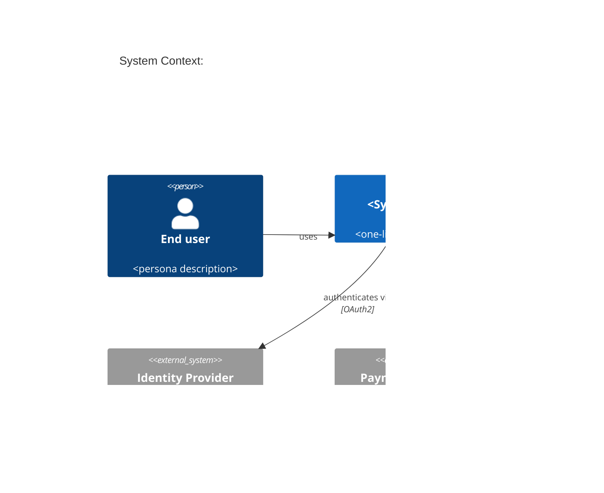
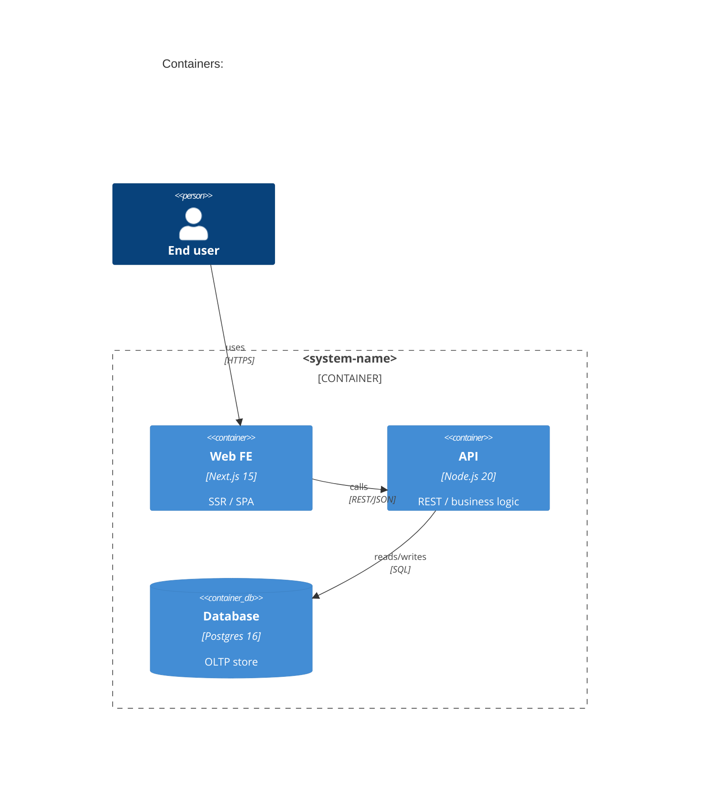

# C4 圖 · 四層架構視圖 · Quick (≤ 12 行) · 工作包

**何時用：** 跨系統整合、新人 onboarding、stakeholder 溝通架構時

**AI 加速：** 用 Claude 從現有 codebase + ADR → C4 diagram 描述（PlantUML/Mermaid）

## Agent 協作規則

1. 這份工作包定義輸出品質，不代表上游文件必須依序存在。
2. 先搜尋 Repository、既有文件、設定與測試；找到等價證據即可使用，並標示來源路徑。
3. 人類負責需求、限制、驗收標準與衝突決策。不得替人類猜測決策。
4. 先回報 FOUND、MISSING、CONFLICT。只有缺口會改變輸出時才提問，每次最多 5 題。
5. 資訊不足但不阻擋草稿時保留 TODO，並註明需要什麼證據，不得編造。

## 輸出範本

```
---
doc_type: "c4-diagram"
variant: "light"
status: "draft"
owner: "<your-name>"
last_updated: "YYYY-MM-DD"
upstream:
  required: ["codebase-structure", "adr"]
  optional: ["stakeholder-map"]
---

# C4 Architecture: <system-name>

**Status:** Draft · **Owner:** <Architect> · **Last updated:** YYYY-MM-DD

> [!IMPORTANT]
> **AI 填寫規則：** 本範本 5 段（編號 1, 2, 3, 9, 12），全部必填——刻意沿用完整版的章節編號讓兩版可對照。輕量版只畫 Level 1 (Context) + Level 2 (Container) 兩層。每結論行內加 `（依據：codebase §XXX / ADR-NNN）`；每欄位帶 `[H]/[M]/[L]` confidence badge；缺資料寫 `_TODO: 需要 XXX_` 不編造模組；**分層紀律：Level 1 只放 system + actor + external，Level 2 才放 container**，任何混層必須在 Omitted 段解釋。

---

## 1. Executive Summary

<!-- ai-fill: 3-5 行說明本圖讀者、抽象層、不畫的部分 -->

<3-5 行說明：本圖給誰看、含哪些層、為何不畫某層>

> **TL;DR:** <一句話：系統邊界 + 主要外部依賴>

---

## 2. Level 1 — System Context

<!-- ai-rule: 只放本 system + actor + external systems。不能出現 container / component -->



### Actors & External Systems

| Element | Type | Responsibility | Source |
|---|---|---|---|
| End user | Actor | <persona> | <ref> |
| Identity Provider | External | OAuth2 IdP | ADR-002 |
| Payment Gateway | External | 收款 | ADR-003 |

---

## 3. Level 2 — Containers

<!-- ai-rule: 列出 ≤ 7 個 container。每個 container 必含 tech + responsibility -->



| Container | Tech | Responsibility | Confidence | Source |
|---|---|---|---|---|
| Web FE | Next.js 15 | SSR + SPA | **[H]** | ADR-001 |
| API | Node.js 20 | Business logic | **[H]** | ADR-001 |
| Database | Postgres 16 | OLTP store | **[H]** | ADR-004 |

---

## 9. Architecture Risks

<!-- ai-rule: 至少列 3 個架構風險（單點故障 / cyclic dependency / 跨 boundary chatty call） -->

> **R1:** <e.g. API → DB 單點故障> — **Severity:** H — **Follow-up:** 開 ADR 評估 read replica
>
> **R2:** ...
>
> **R3:** ...

---

## 12. Confidence & Sources & TODO

- **整份文件最低 confidence 欄位：** <列出所有 [L] 與 [M]>
- **Fabricated assumptions（推測但 input 未明說）：**
  - <假設 1：例：假設 IdP 是 external（codebase 沒明示）>
- **Highest-value next input:** <下一份最該補的：deployment topology / ADR / DDD context map>

### TODO（缺資料）

- _TODO: 需要 SA 確認 Payment Gateway 是同步 vs webhook 模式_

---

> [!CAUTION]
> **輸出前 AI 自檢：**
> - [ ] 5 段 H2 章節齊全（編號 1, 2, 3, 9, 12，刻意不連號）
> - [ ] Level 1 (Context) 不含 container / component
> - [ ] Level 2 (Container) 每個 container 含 tech + responsibility + confidence
> - [ ] 每個 element / relationship 有 source（codebase / ADR ref）
> - [ ] ≥ 3 個架構風險點（單點 / cyclic / chatty）
> - [ ] Mermaid C4 語法可渲染（C4Context / C4Container）
> - [ ] 無 YAML / JSON schema 輸出（C4 是給人讀的 markdown + mermaid）
```
