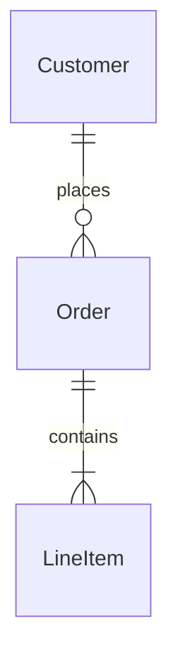

# Data Model · 資料模型 · Quick (≤ 12 行) · 工作包

**何時用：** 新 entity、跨系統資料整合、合規/稽核產業時

**AI 加速：** 用 Claude 從 SRS + business rules → ERD + DDL 草稿

## Agent 協作規則

1. 這份工作包定義輸出品質，不代表上游文件必須依序存在。
2. 先搜尋 Repository、既有文件、設定與測試；找到等價證據即可使用，並標示來源路徑。
3. 人類負責需求、限制、驗收標準與衝突決策。不得替人類猜測決策。
4. 先回報 FOUND、MISSING、CONFLICT。只有缺口會改變輸出時才提問，每次最多 5 題。
5. 資訊不足但不阻擋草稿時保留 TODO，並註明需要什麼證據，不得編造。

## 輸出範本

```
---
doc_type: "data-model"
variant: "light"
status: "draft"
owner: "<your-name>"
last_updated: "YYYY-MM-DD"
upstream:
  required: ["srs", "business-rules"]
  optional: ["existing-er"]
---

# Data Model: <bounded-context-name>

**Status:** Draft · **Owner:** <Architect/Dev> · **Last updated:** YYYY-MM-DD

> [!IMPORTANT]
> **AI 填寫規則：** 本範本 6 段（編號 1, 2, 3, 6, 10, 12），全部必填——刻意沿用完整版的章節編號讓兩版可對照。每結論行內加 `（依據：srs §XXX）`；每欄位帶 `[H]/[M]/[L]` confidence badge；缺資料寫 `_TODO: 需要 XXX_` 不編造欄位；**每個 entity 必含 audit 欄位（created_at / updated_at / version / deleted_at）**，不可省略；輕量版可省略合規 / 加密 / retention，但若涉 PII 必須升級到完整版。

---

## 1. Executive Summary

<!-- ai-fill: 3-5 行說明本模型範圍、核心 entity、是否涉 PII -->

<3-5 行說明>

> **TL;DR:** <一句話：N 個 entity，涵蓋哪個 BC>

---

## 2. Entities

<!-- ai-rule: 每個 entity 必含 audit 欄位（created_at / updated_at / version / deleted_at） -->

### Order · **[H]**

| Field | Type | Nullable | Constraints | Notes |
|---|---|---|---|---|
| `id` | uuid (v7) | [NO] | PK | |
| `customer_id` | uuid | [NO] | FK → Customer | |
| `status` | enum | [NO] | `PENDING/PAID/SHIPPED/CANCELLED` | state machine |
| `total_cents` | bigint | [NO] | check > 0 | 金額用整數存 |
| `created_at` | timestamptz | [NO] | audit, default `now()` | UTC |
| `updated_at` | timestamptz | [NO] | audit | trigger 更新 |
| `version` | int | [NO] | audit, optimistic lock | |
| `deleted_at` | timestamptz | [YES] | audit, soft delete | |

### Customer · **[H]**

...

---

## 3. Relationships



| From | To | Cardinality | FK | On delete | Confidence |
|---|---|---|---|---|---|
| Order | Customer | N:1 | `customer_id` | RESTRICT | **[H]** |
| LineItem | Order | N:1 | `order_id` | CASCADE | **[H]** |

---

## 6. Indexes（核心 query 覆蓋）

<!-- ai-rule: 列出覆蓋主要 query 的 index，至少 2-3 個 -->

| Entity | Index name | Type | Columns | Covers query |
|---|---|---|---|---|
| Order | `idx_order_customer_created` | B-tree | `(customer_id, created_at DESC)` | 用戶訂單列表（最新優先） |
| Order | `idx_order_status` | B-tree | `(status)` | 後台依狀態篩選 |

---

## 10. Decision Log

<!-- ai-rule: 每條必含 chosen + 至少 1 個 rejected option + 拒絕原因 -->

| Date | Decision | Options | Chosen | Rejected why | Confidence |
|---|---|---|---|---|---|
| YYYY-MM-DD | PK 策略 | auto-increment / uuid v4 / uuid v7 | uuid v7 | auto-increment (分散式發號難)、uuid v4 (B-tree fragmentation) | **[H]** |

---

## 12. Confidence & Sources & TODO

- **整份文件最低 confidence 欄位：** <列出所有 [L] 與 [M]>
- **Fabricated assumptions（推測但 input 未明說）：**
  - <假設 1：例：假設 soft delete（input 沒明說）>
- **Highest-value next input:** <下一份最該補的資料>

### TODO（缺資料）

- _TODO: 需要確認 Order.status 是否需保留歷史 transition log_

---

> [!CAUTION]
> **輸出前 AI 自檢：**
> - [ ] 6 段 H2 章節齊全（編號 1, 2, 3, 6, 10, 12，刻意不連號）
> - [ ] 每個 entity 含 audit 欄位（created_at / updated_at / version / deleted_at）
> - [ ] Relationships 段有 mermaid erDiagram
> - [ ] 每個 FK 標 on_delete 行為（RESTRICT / CASCADE / SET NULL）
> - [ ] Index 至少覆蓋 2 個主要 query pattern
> - [ ] 若涉 PII 欄位，**必須升級到完整版**（含加密 / retention / GDPR erasure）
> - [ ] Decision Log ≥ 1 條，每條有 rejected reason
> - [ ] 無 YAML / JSON schema 輸出（migration DDL 由 ORM 衍生）
```
